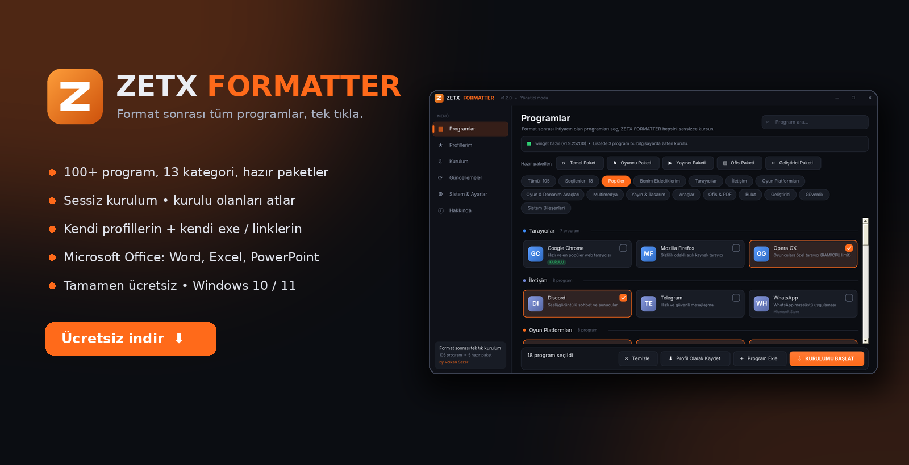
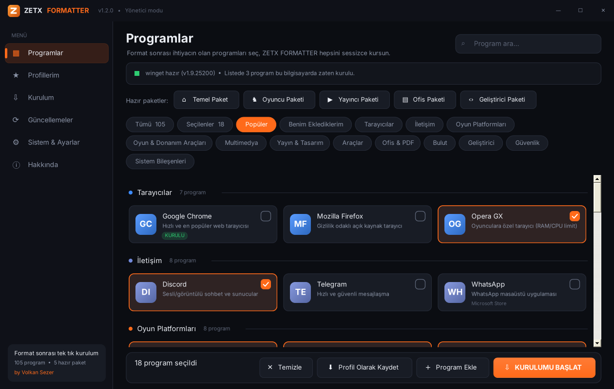
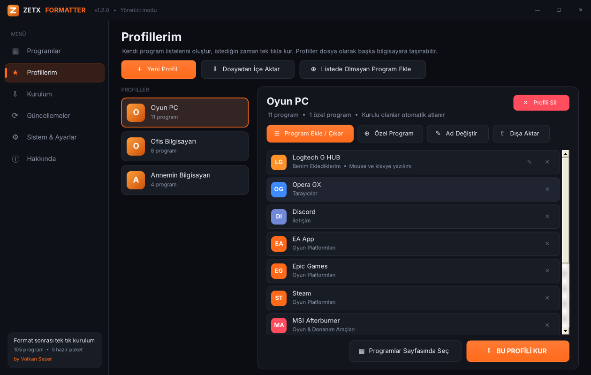
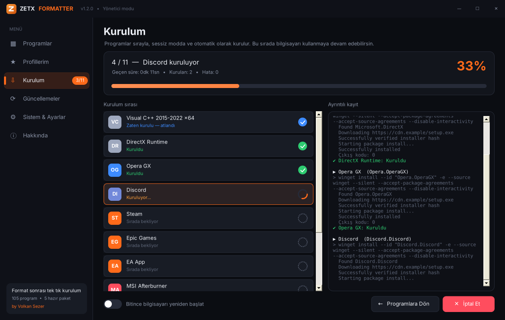
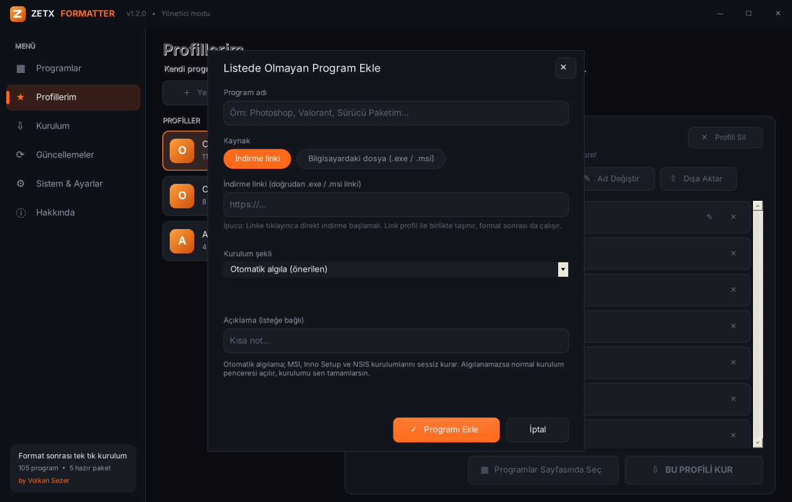
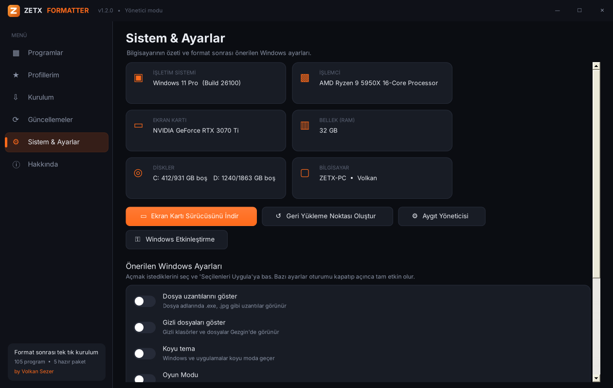
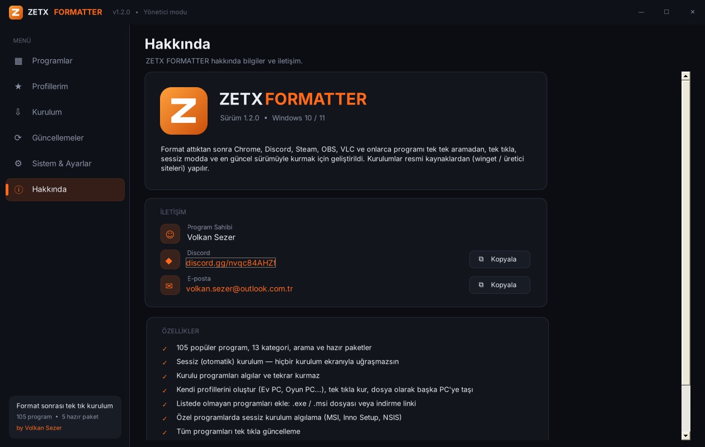

  

<h1 align="center">ZETX FORMATTER</h1>

  <b>Ücretsiz</b> format sonrası program kurulum aracı — Chrome, Discord, Steam, OBS, VLC, Microsoft Office ve 100'den fazla programı tek tıkla, sessiz ve otomatik kurar.  
  <a href="https://github.com/wolkansezer/ZETX-FORMATTER/releases/latest/download/ZETX-FORMATTER.exe"><b>⬇ ZETX-FORMATTER.exe indir</b></a> •
  <a href="https://github.com/wolkansezer/ZETX-FORMATTER/releases/latest/download/ZETX-FORMATTER.zip">ZIP olarak indir</a> •
  <a href="https://github.com/wolkansezer/ZETX-FORMATTER/releases">Tüm sürümler</a> •
  <a href="https://discord.gg/nvqc84AHZf">Discord</a>

---

## Ekran Görüntüleri

| Programlar | Profillerim |
|:---:|:---:|
|  |  |
| **Kurulum** | **Listede Olmayan Program Ekle** |
|  |  |
| **Sistem & Ayarlar** | **Hakkında** |
|  |  |

Görseller programın arayüzünü temsil eder; sistem bilgileri örnektir ve her bilgisayarda farklıdır.

---

## Özellikler

- **100+ program, 13 kategori** — tarayıcılar, iletişim, oyun platformları, oyun ve donanım araçları, multimedya, yayın ve tasarım, ofis, bulut, geliştirici, güvenlik ve sistem bileşenleri (Visual C++, DirectX, .NET)
- **Microsoft Office** — Word, Excel, PowerPoint, Outlook, OneNote ve Access; istediğini tek tek seç, hepsi tek seferde kurulur
- **Hazır paketler** — Temel, Oyuncu, Yayıncı, Ofis ve Geliştirici paketleri tek tıkla seçilir
- **Sessiz kurulum** — hiçbir kurulum ekranıyla uğraşmazsın, programlar sırayla otomatik kurulur
- **Kurulu olanları atlar** — bilgisayarında zaten olan programları tanır ve tekrar kurmaz
- **Profillerim** — kendi program listelerini oluştur (ör. "Oyun PC", "Ofis Bilgisayarı"), tek tıkla kur, `.zetx` dosyası olarak başka bilgisayara taşı
- **Listede olmayan program ekle** — kendi `.exe` / `.msi` dosyanı veya indirme linkini ekle; MSI, Inno Setup ve NSIS kurulumları otomatik algılanıp sessiz kurulur
- **Güncellemeler** — bilgisayardaki tüm programları tek tıkla güncelle
- **Sistem & Ayarlar** — sistem özeti, ekran kartına göre sürücü sayfası, geri yükleme noktası ve önerilen Windows ayarları (dosya uzantıları, koyu tema, Oyun Modu, fare ivmesi, Nihai Performans güç planı...)
- **winget yoksa** — tek tıkla kurar/onarır; Chrome, Discord, Steam gibi programlar winget olmadan da doğrudan indirilip kurulabilir

## Kurulum ve Kullanım

1. [ZETX-FORMATTER.exe](https://github.com/wolkansezer/ZETX-FORMATTER/releases/latest/download/ZETX-FORMATTER.exe) dosyasını indir (kurulum gerektirmez, tek dosya).
2. Çalıştır ve yönetici izni (UAC) iste dendiğinde **Evet** de.
3. Kurmak istediğin programları seç ya da bir hazır paket / profil seç.
4. **KURULUMU BAŞLAT**'a bas — gerisini ZETX FORMATTER halleder.

> **Windows SmartScreen uyarısı:** Program imzasız olduğu için "Windows bilgisayarınızı korudu" uyarısı çıkabilir. **Ek bilgi → Yine de çalıştır** ile devam edebilirsin.

> **Microsoft Office:** Office, Microsoft'un resmi dağıtım aracıyla kurulur. Kullanmak için ilk açılışta Microsoft hesabınla oturum açman ve geçerli bir Microsoft 365 aboneliğin olması gerekir.

## Gereksinimler

- Windows 10 veya Windows 11 (64-bit)
- İnternet bağlantısı
- Ek bir şey gerekmez — Windows'ta hazır gelen .NET Framework 4.8 ile çalışır

## Kaynaktan Derleme

Kaynak kod `kaynak/` klasöründedir. Windows'ta `derle.bat` dosyasını çalıştırman yeterli; Windows'ta hazır gelen .NET Framework derleyicisiyle `ZETX-FORMATTER.exe` oluşturulur.

## İletişim

- **Program sahibi:** Volkan Sezer
- **Discord:** [discord.gg/nvqc84AHZf](https://discord.gg/nvqc84AHZf)
- **E-posta:** [volkan.sezer@outlook.com.tr](mailto:volkan.sezer@outlook.com.tr)

---

© 2026 Volkan Sezer — ZETX

